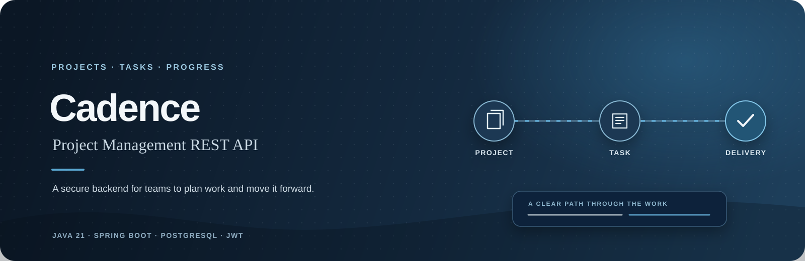
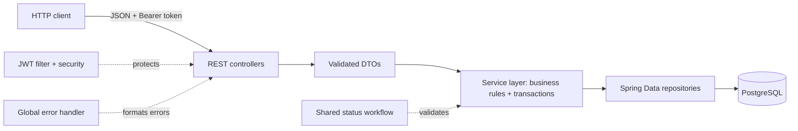
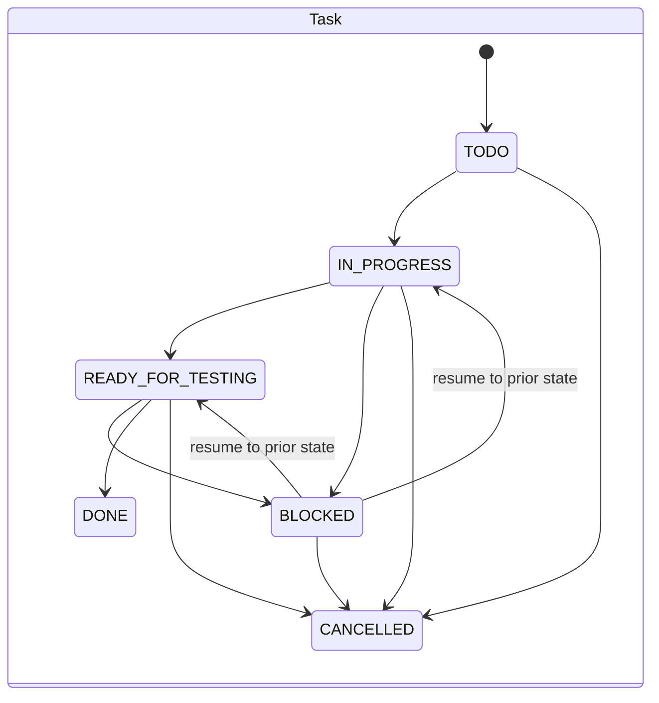
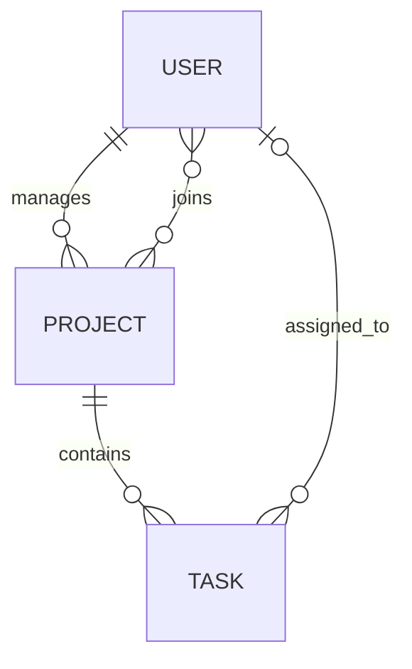

<div align="center">



<br />

[](https://cadence-t6ui.onrender.com/swagger-ui.html)

<br />

`JAVA 21` &nbsp; · &nbsp; `SPRING BOOT 3.5` &nbsp; · &nbsp; `POSTGRESQL 16` &nbsp; · &nbsp; `JWT`

</div>

<br />

> **The idea** &nbsp; Give teams a dependable API for projects and tasks, with clear rules for ownership, deadlines, authentication, and how work changes state.

---

## ◈ Explore

<div align="center">

| &nbsp;01&nbsp; **Overview** | &nbsp;02&nbsp; **Workflow** | &nbsp;03&nbsp; **Quick start** | &nbsp;04&nbsp; **API** |
|:---:|:---:|:---:|:---:|
| [What it does](#what-it-does) | [Status rules](#status-workflows) | [Run with Docker](#run-with-docker) | [Endpoints](#api-at-a-glance) |

</div>

## What it does

Cadence is a backend-only project management REST API built with Java and Spring Boot. It models teams, projects, and tasks (user stories), and enforces business rules in the service layer. Explore the API through the hosted or local Swagger UI.

| **Projects & teams** | **Tasks & deadlines** | **Safe state changes** |
|:---|:---|:---|
| Create projects, assign a manager, and add developer members. | Track story points, due dates, optional assignees, and derived deadline fields. | JWT-protected business routes, validated requests, and workflow-checked project and task statuses. |

Other features include BCrypt password hashing, consistent JSON errors, caching for project reads, OpenAPI documentation, Docker Compose, and a GitHub Actions build-and-test workflow.

## How it fits together



Controllers expose DTOs rather than persistence entities. Services own business rules and transactions, repositories handle persistence, and shared security, workflow, and error handling apply across the API.

## Status workflows

Status updates follow explicit paths. Skipping steps or changing a terminal status returns `409 Conflict`. A blocked or on-hold item can resume only to the state it left.



Project states are `PLANNED → IN_PROGRESS → COMPLETED`, with `ON_HOLD` as a pausable state that resumes to `IN_PROGRESS`. Both workflows allow cancellation before a terminal state; `DONE`, `COMPLETED`, and `CANCELLED` are final.

## Data model



A project has one manager and can have multiple developer members. A task belongs to one project and may be assigned to a user.

## Get started

### Requirements

- Java **21**
- Docker and Docker Compose, or PostgreSQL **16** plus the included Maven wrapper

### Run with Docker

From the project root:

```bash
git clone https://github.com/atandritC/Cadence.git
cd Cadence
docker compose up --build
```

The API will be available at <http://localhost:8080>. Open the local Swagger UI at <http://localhost:8080/swagger-ui.html>.

The Compose file uses the local development database credentials defined in `docker-compose.yml`. Change them and set a strong `APP_JWT_SECRET` before exposing a deployment beyond your machine.

### Run with a local PostgreSQL database

Create the database and development user:

```sql
CREATE DATABASE cadence;
CREATE USER cadence WITH PASSWORD 'cadence';
GRANT ALL ON SCHEMA public TO cadence;
```

Then start the application:

```bash
./mvnw spring-boot:run
```

The default local datasource points to `localhost:5432/cadence`. Configure a different database or JWT settings with the environment variables below.

| Variable | Purpose | Default |
|:--|:--|:--|
| `SPRING_DATASOURCE_URL` | JDBC connection string | `jdbc:postgresql://localhost:5432/cadence` |
| `SPRING_DATASOURCE_USERNAME` | Database user | `cadence` |
| `SPRING_DATASOURCE_PASSWORD` | Database password | `cadence` |
| `APP_JWT_SECRET` | Signing key for issued JWTs | Development default; replace outside local use |
| `APP_JWT_EXPIRATION_MS` | Token lifetime in milliseconds | `86400000` (24 hours) |
| `PORT` | HTTP port | `8080` |

## Try the API

### Register and get a token

```bash
curl -X POST http://localhost:8080/cadence/auth/register \
  -H 'Content-Type: application/json' \
  -d '{"email":"you@example.com","fullName":"Your Name","password":"change-me"}'
```

The response contains a JWT in `token`. Use it as a bearer token for protected routes:

```bash
curl http://localhost:8080/cadence/users \
  -H 'Authorization: Bearer YOUR_TOKEN'
```

Swagger UI also supports authenticated requests: call `/cadence/auth/register` or `/cadence/auth/login`, copy `token`, choose **Authorize**, then enter the token.

## API at a glance

All business endpoints require a JWT. Registration, login, and Swagger/OpenAPI routes are public.

| Method | Endpoint | Purpose |
|:--|:--|:--|
| `POST` | `/cadence/auth/register` | Register an account and issue a token |
| `POST` | `/cadence/auth/login` | Authenticate and issue a token |
| `GET` | `/cadence/users` · `/cadence/users/{id}` | List users or get one user |
| `POST` | `/cadence/projects` | Create a project |
| `GET` | `/cadence/projects/{id}` | Get a project |
| `GET` | `/cadence/projects?managerId={id}` | List projects for a manager |
| `POST` | `/cadence/projects/{id}/members/{userId}` | Add a project member |
| `PATCH` | `/cadence/projects/{id}/status` | Apply a valid project transition |
| `POST` | `/cadence/tasks` | Create a task or user story |
| `GET` | `/cadence/tasks/{id}` | Get a task |
| `GET` | `/cadence/tasks?projectId={id}` | List a project’s tasks |
| `PATCH` | `/cadence/tasks/{id}/status` | Apply a valid task transition |

## Business rules & responses

- A task’s due date cannot be later than its project’s due date.
- Story points cannot be negative.
- `remainingDays`, `overdue`, and project `totalStoryPoints` are derived for responses rather than stored as mutable totals.
- Invalid workflow transitions and duplicate resources return `409`; missing resources return `404`; business-rule violations return `422`; validation errors return `400`.

Errors use a consistent JSON response with a timestamp, status, message, and optional field details.

## Run the tests

Start PostgreSQL first (for example, with `docker compose up -d db`), then run:

```bash
./mvnw test
```

The suite includes a Spring application context test, service tests, and unit tests for the shared status workflow. The CI workflow starts PostgreSQL automatically.

## CI

A GitHub Actions workflow runs on pushes and pull requests to `main`. It provisions PostgreSQL 16, sets up JDK 21, then runs `./mvnw --batch-mode clean verify`.

## Known limitations

- Cadence is an API project; it does not include a web user interface.
- The hosted Swagger UI runs on a free Render service and may need time to wake after inactivity.
- The included Docker Compose credentials are for local development. Set your own database credentials and JWT signing secret for any shared deployment.
- The project uses Hibernate schema update (`ddl-auto=update`); it does not currently include a database migration tool.

---

<div align="center">

**Cadence** &nbsp; · &nbsp; Projects, tasks, and progress in rhythm.

[Explore the Swagger UI →](https://cadence-t6ui.onrender.com/swagger-ui.html)

</div>
